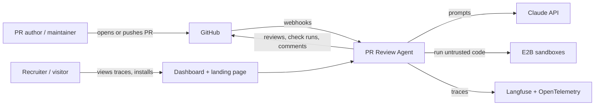
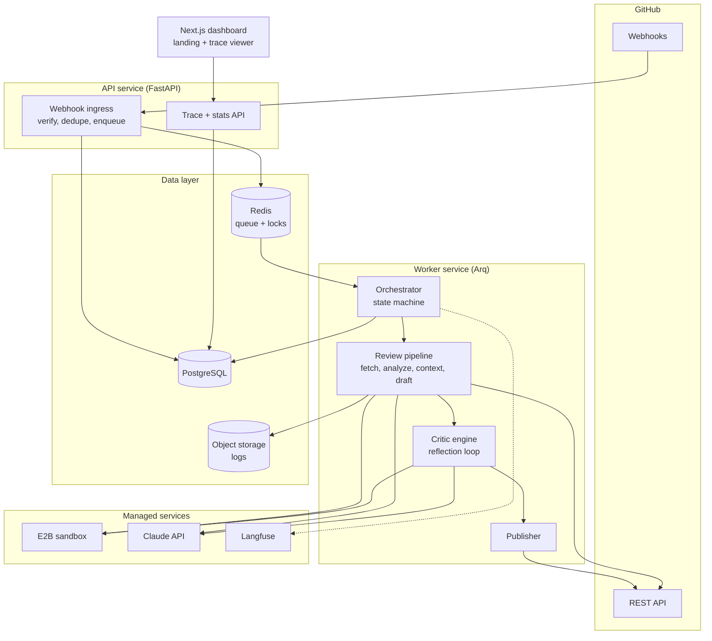
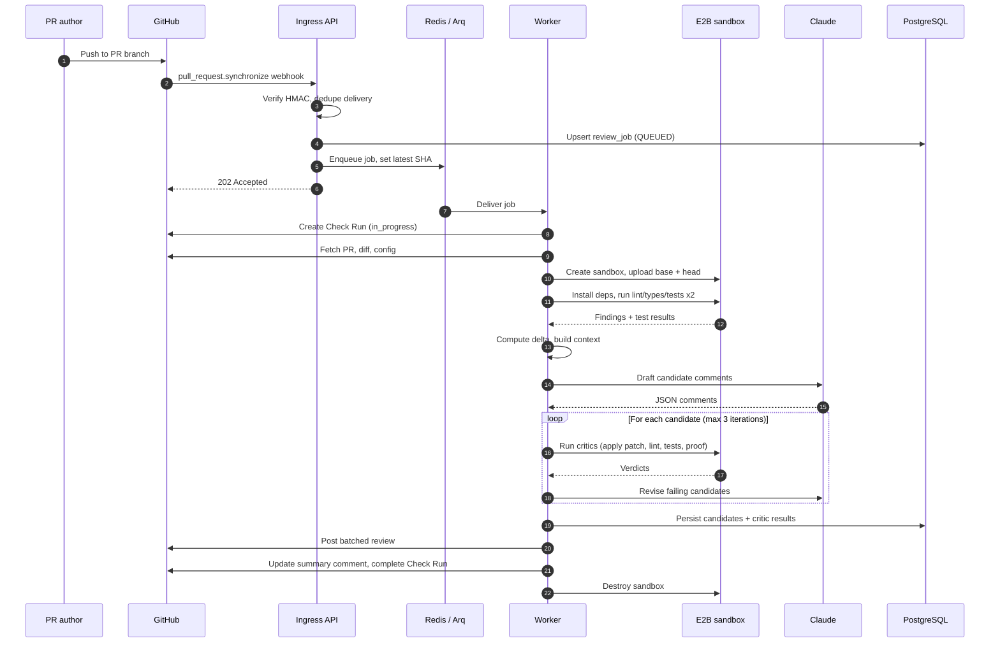
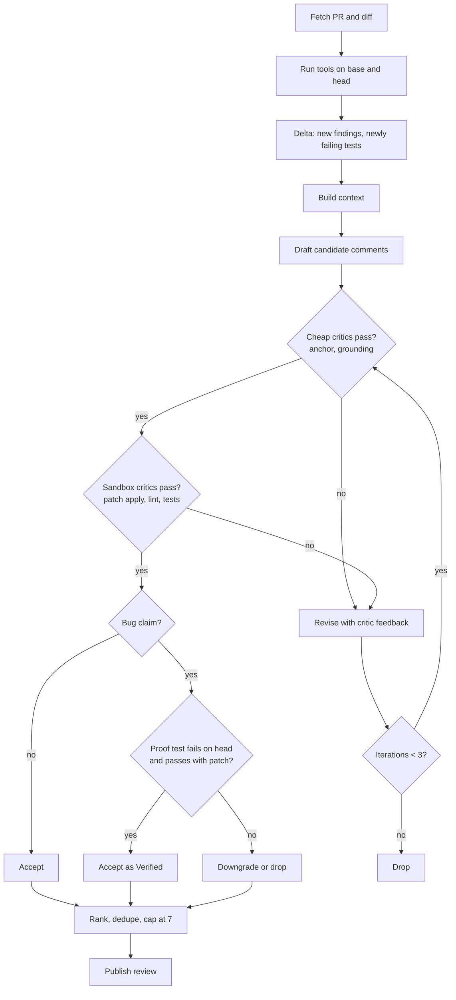
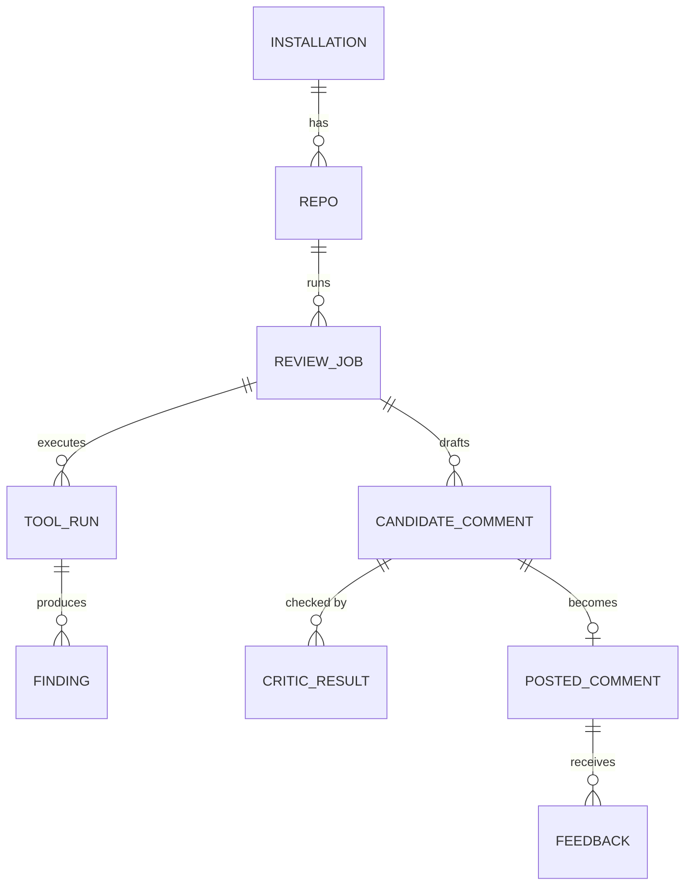
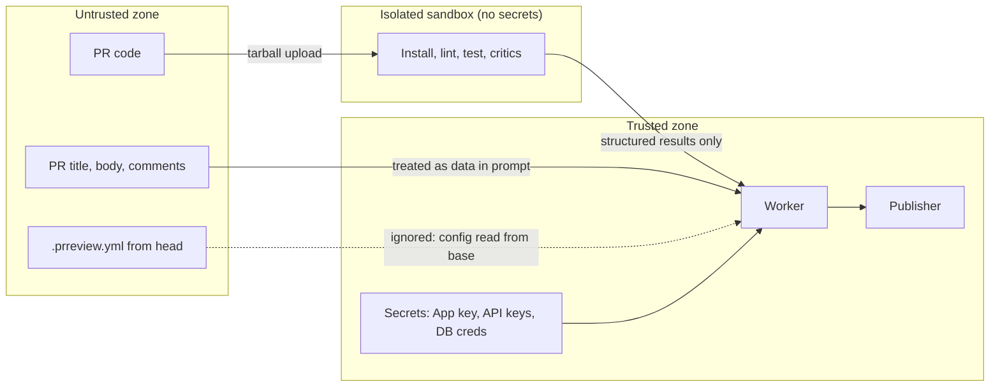
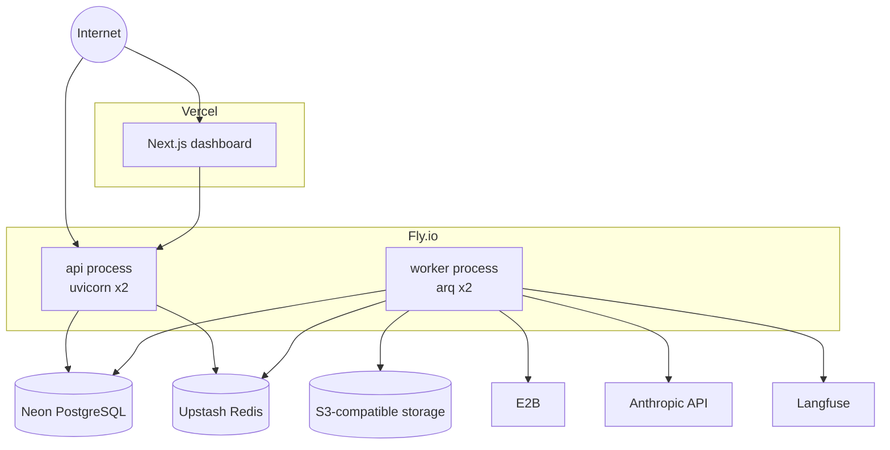
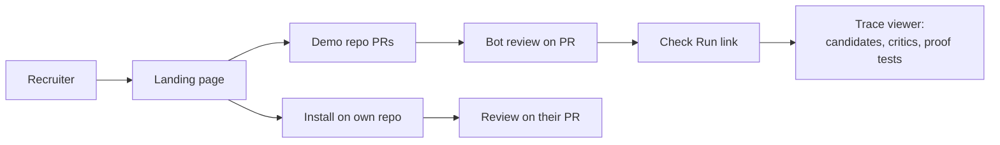

# High-Level Design: PR Review Agent (GitHub App)

| Field     | Value                                                                 |
| --------- | --------------------------------------------------------------------- |
| Document  | High-Level Design (HLD)                                               |
| System    | PR Review Agent                                                       |
| Version   | 1.0                                                                   |
| Stack     | Python 3.12, FastAPI, Arq/Redis, PostgreSQL, E2B, Claude API, Next.js |
| Companion | `LLD-pr-review-agent.md`                                            |

---

## 1. Overview

PR Review Agent is a GitHub App that reviews pull requests automatically. When a PR is opened or updated, it:

1. Reads the pull request and its diff.
2. Runs the repository's own linters, type checkers and tests inside an isolated sandbox, on both the base and the head commit.
3. Uses an LLM (Claude) to draft review comments, grounded in the diff, surrounding code and the tool results.
4. Passes every draft comment through **deterministic critics** (the anchor check, symbol grounding, patch application, lint, tests and a bug-proof test) in a reflection loop. Comments are revised or dropped until they pass.
5. Posts the surviving comments as a single GitHub review, plus a Check Run and a summary comment.

The defining property of the system is that **comments which make claims are backed by execution**. A suggested fix has been applied and tested. A claimed bug has a failing test that proves it. Comments that pass the bug-proof critic are marked *Verified*.

### 1.1 Problem statement

LLM-based review bots are noisy. They hallucinate symbols, comment on lines they cannot anchor to, suggest fixes that don't compile, and repeat what linters already say. Developers quickly learn to ignore them. This system trades recall for precision: it posts fewer comments, and every comment must survive mechanical verification.

### 1.2 Goals

| ID | Goal                                                                            |
| -- | ------------------------------------------------------------------------------- |
| G1 | Post a review within 5 minutes (p50) of a push for PRs under 500 changed lines  |
| G2 | Comment precision of 80% or higher on the evaluation dataset                    |
| G3 | Every suggested patch applies cleanly and keeps previously passing tests green  |
| G4 | Untrusted PR code can never access secrets or the network during test execution |
| G5 | Any GitHub user can install the app and get a review without manual onboarding  |
| G6 | The full reasoning trace for every review is viewable on a web page             |

### 1.3 Non-goals (v1)

- Pushing commits to PR branches or auto-merging.
- Blocking merges (`REQUEST_CHANGES`). The bot only comments.
- Languages other than Python and TypeScript/JavaScript.
- GitHub Enterprise Server, GitLab or Bitbucket.
- Self-hosted deployment for customers.

### 1.4 Success metrics

| Metric                   | Definition                                                   | Target           |
| ------------------------ | ------------------------------------------------------------ | ---------------- |
| Precision (offline)      | Correct comments / posted comments on eval set               | ≥ 80%           |
| Recall (offline)         | Seeded bugs found / seeded bugs                              | ≥ 50%           |
| Verified rate            | Bug comments with passing bug-proof / all bug comments       | ≥ 40%           |
| Acceptance rate (online) | Comments with 👍, resolved, or suggestion committed / posted | ≥ 50%           |
| Latency p50 / p95        | Webhook received → review posted                            | 3 min / 8 min    |
| Cost per review          | LLM + sandbox spend                                          | ≤ $0.30 average |

---

## 2. Stakeholders and use cases

| Actor                 | Use case                                                                                                 |
| --------------------- | -------------------------------------------------------------------------------------------------------- |
| PR author             | Receives line-level comments with one-click suggestions; can ask`@prreview explain` in a thread        |
| Maintainer            | Installs the app, tunes behaviour with`.prreview.yml`, sees a Check Run per PR                         |
| Recruiter / evaluator | Opens the demo repo, sees reviews on seeded-bug PRs, opens the trace viewer; optionally installs the app |
| Operator (you)        | Monitors cost, failures and quality; runs evals; uses the kill switch                                    |

---

## 3. System context

External dependencies:

| Dependency                 | Purpose                                             | Failure impact                                       |
| -------------------------- | --------------------------------------------------- | ---------------------------------------------------- |
| GitHub REST API + webhooks | Source of PR events; destination of reviews         | System idle; jobs retry                              |
| Anthropic Claude API       | Drafting and revising comments, writing proof tests | Jobs retry, then publish lint/test-only summary      |
| E2B                        | Isolated execution of PR code                       | Jobs fall back to diff-only review, clearly labelled |
| Neon PostgreSQL            | System of record                                    | Hard dependency                                      |
| Upstash Redis              | Job queue, locks, latest-SHA keys                   | Hard dependency                                      |
| S3-compatible storage      | Tool logs, sandbox output                           | Logs missing; reviews still post                     |
| Langfuse                   | LLM traces                                          | Observability degraded only                          |

---

## 4. Architecture overview

### 4.1 Architectural principles

1. **Thin ingress, fat workers.** The webhook endpoint only verifies, dedupes and enqueues, so it always answers GitHub well inside the 10-second timeout.
2. **Deterministic code decides; the LLM proposes.** The model only emits schema-validated JSON. Code decides what is posted.
3. **Untrusted by default.** PR code, PR text and repo config are all untrusted input.
4. **Resumable, idempotent steps.** Every job step persists its output before advancing, so a crashed worker can resume.
5. **Precision over recall.** When in doubt, drop the comment.
6. **Everything traceable.** Every candidate comment, critic verdict and revision is stored and viewable.

---

## 5. Components

### 5.1 GitHub App

Registered GitHub App with least-privilege permissions.

| Permission    | Access       | Reason                                            |
| ------------- | ------------ | ------------------------------------------------- |
| Pull requests | Read & write | Read PRs and diffs, post reviews                  |
| Contents      | Read         | Fetch repository code                             |
| Checks        | Read & write | Create and update Check Runs                      |
| Issues        | Read & write | Summary comment, respond to`@prreview` commands |
| Metadata      | Read         | Mandatory                                         |

Subscribed events: `pull_request`, `pull_request_review_comment`, `issue_comment`, `installation`, `installation_repositories`.

Contents **write** is intentionally not requested. Even a fully compromised system cannot push code.

### 5.2 Ingress API (FastAPI)

- Verifies `X-Hub-Signature-256` (HMAC-SHA256 with the webhook secret).
- Dedupes on `X-GitHub-Delivery`.
- Routes events: PR events create review jobs; installation events upsert installations and repos; comment events handle commands and feedback.
- Enqueues work and returns `202`.

### 5.3 Job queue (Redis + Arq)

- One job per `(repo, PR, head SHA)`; the job ID doubles as the dedupe key.
- A Redis key holds the latest head SHA per PR, so older jobs cancel themselves.
- Per-installation concurrency and daily quotas are enforced before enqueue.

### 5.4 Orchestrator

Drives each job through a persisted state machine: `QUEUED → FETCHING → SANDBOX_READY → ANALYZED → DRAFTED → REFLECTING → PUBLISHING → DONE`, with `FAILED` and `CANCELLED` as terminal states reachable from any step.

### 5.5 Review pipeline

| Stage         | Responsibility                                                                                              |
| ------------- | ----------------------------------------------------------------------------------------------------------- |
| Fetch         | PR metadata, diff, file list, base/head SHAs, repo config from base branch                                  |
| Sandbox setup | Create sandbox, upload base and head snapshots, install dependencies                                        |
| Analysis      | Detect toolchain; run lint, type checks, Semgrep and tests on base and head; compute delta                  |
| Context       | Build an LLM context from diff, touched symbols, callers, PR text and delta findings, within a token budget |
| Draft         | Generate candidate comments per category as structured JSON                                                 |

### 5.6 Critic engine (reflection)

Runs ordered, deterministic critics on each candidate comment. Failures are fed back to the LLM for revision, up to 3 iterations; unresolvable comments are dropped.

| Critic        | Verifies                                        | Needs sandbox |
| ------------- | ----------------------------------------------- | ------------- |
| Anchor        | Line is commentable in the diff                 | No            |
| Grounding     | Identifiers mentioned exist in the repo         | No            |
| Patch applies | Suggested patch applies to head                 | Yes           |
| Patch lint    | Patched code passes lint and type checks        | Yes           |
| Patch tests   | Previously passing tests still pass with patch  | Yes           |
| Bug proof     | Generated test fails on head, passes with patch | Yes           |

### 5.7 Publisher

- One batched review (`event: COMMENT`) pinned to the head SHA.
- Fixes rendered as GitHub `suggestion` blocks where possible.
- A single summary comment, edited in place on each push.
- A Check Run showing progress and final results, linking to the trace viewer.

### 5.8 Dashboard (Next.js)

- Landing page with install button, demo repo link, live stats.
- Trace viewer showing each candidate comment, every critic result per iteration, proof tests and the final comment.

---

## 6. End-to-end flow

---

## 7. Review pipeline and reflection loop

**Why base vs head:** running tools on both commits isolates what *this PR* changed. Pre-existing lint errors and already-failing tests are never attributed to the author.

---

## 8. Data architecture

### 8.1 Core entities

### 8.2 Storage choices

| Data                                                           | Store          | Retention                   |
| -------------------------------------------------------------- | -------------- | --------------------------- |
| Installations, repos, jobs, comments, critic results, feedback | PostgreSQL     | Indefinite (no source code) |
| Webhook delivery IDs                                           | PostgreSQL     | 30 days                     |
| Queue, locks, latest-SHA keys, rate counters                   | Redis          | Ephemeral                   |
| Tool logs, sandbox stdout/stderr                               | Object storage | 7 days                      |
| Source code snapshots                                          | Sandbox only   | Destroyed at job end        |
| LLM traces                                                     | Langfuse       | 14 days                     |

Source code is never persisted outside the sandbox and short-lived logs.

---

## 9. Security architecture

### 9.1 Trust boundaries

### 9.2 Threats and mitigations

| Threat                                           | Mitigation                                                                                                        |
| ------------------------------------------------ | ----------------------------------------------------------------------------------------------------------------- |
| Malicious test code steals secrets               | No secrets enter the sandbox; repo cloned by worker and uploaded as tarball                                       |
| Malicious code exfiltrates data                  | Network disabled during lint, test and critic phases                                                              |
| Resource exhaustion (fork bombs, infinite loops) | CPU, memory, disk, process and wall-clock limits; sandbox destroyed after job                                     |
| Prompt injection in code or PR text              | Model output constrained to JSON schema; no LLM tool can call GitHub; content delimited and labelled as untrusted |
| PR weakens its own review via config             | `.prreview.yml` read from the **base** branch only                                                        |
| Forged webhooks                                  | HMAC-SHA256 verification with constant-time compare                                                               |
| Replay of webhooks                               | Delivery ID dedupe                                                                                                |
| Token leakage                                    | Installation tokens short-lived, cached in memory/Redis with TTL, never logged                                    |
| Cost abuse by mass installs                      | Per-installation quotas, global daily spend cap, kill switch                                                      |
| Over-privileged app                              | No Contents write; reviews use`COMMENT` only                                                                    |

---

## 10. Scalability and performance

### 10.1 Capacity assumptions (demo scale)

| Parameter                    | Estimate             |
| ---------------------------- | -------------------- |
| Installations                | 50–200              |
| Reviews per day              | 100–500             |
| Peak concurrent jobs         | 10                   |
| Average sandbox time per job | 4 minutes            |
| Average LLM tokens per job   | 60k input, 6k output |

### 10.2 Scaling approach

- **API service** is stateless; scale horizontally behind Fly.io's proxy.
- **Workers** scale by count; each worker runs a bounded number of concurrent jobs (default 4).
- **Sandboxes** are the main cost and latency driver; dependency caching by lockfile hash cuts warm runs below 60 seconds.
- **Critic ordering** runs cheap checks first and short-circuits, reducing sandbox time.
- **Database** load is low; a single Neon instance is sufficient well beyond demo scale.

### 10.3 Latency budget (p50 target ~3 min)

| Step                               | Budget |
| ---------------------------------- | ------ |
| Ingress → job start               | < 5 s  |
| Fetch PR + snapshots               | 10 s   |
| Sandbox create + deps (warm cache) | 40 s   |
| Tools on base + head               | 60 s   |
| Context + draft                    | 20 s   |
| Reflection loop                    | 40 s   |
| Publish                            | 5 s    |

---

## 11. Reliability

| Failure                         | Detection                         | Behaviour                                                        |
| ------------------------------- | --------------------------------- | ---------------------------------------------------------------- |
| Worker crash mid-job            | Arq job timeout / heartbeat       | Job resumes from last persisted state                            |
| GitHub API 5xx / rate limit     | HTTP status, rate-limit headers   | Exponential backoff, max 3 retries                               |
| Claude API rate limit or outage | 429 / 5xx                         | Backoff; after retries, publish tool-only summary                |
| Sandbox creation failure        | Provider error                    | Retry once; fall back to diff-only review labelled as unverified |
| Tests hang                      | Wall-clock timeout                | Kill; mark test results as unavailable                           |
| Newer push during job           | Latest-SHA check before each step | Job cancels itself; new job proceeds                             |
| Duplicate webhook               | Delivery ID conflict              | Ignored                                                          |
| Invalid review anchor (422)     | GitHub response                   | Remove offending comment, retry publish                          |

---

## 12. Observability

- **Tracing:** OpenTelemetry spans per job and per step across API and worker, exported to an OTLP backend.
- **LLM tracing:** every prompt, response, token count and cost in Langfuse, tagged with job ID.
- **Metrics:** jobs by state, step durations, critic pass rates, comments posted, cost per job, acceptance rate.
- **Logs:** structured JSON with `job_id`, `installation_id`, `repo`, `pr`.
- **Alerts:** failure rate > 20% over 30 min; daily spend > 80% of cap; queue depth > 50.

---

## 13. Cost model

| Item                                      | Per review (estimate)     |
| ----------------------------------------- | ------------------------- |
| Claude drafting + revisions + proof tests | $0.10 – $0.25            |
| Sandbox minutes                           | $0.02 – $0.06            |
| Infrastructure (amortized)                | < $0.01                   |
| **Total**                           | **~$0.15 – $0.30** |

Controls: per-job `CostMeter` hard cap ($0.50), per-installation daily quota, global daily cap, skip generated/vendored files, max diff size.

---

## 14. Deployment architecture

- One container image, two Fly.io process groups (`api`, `worker`).
- Separate **dev** and **prod** GitHub Apps with separate secrets and databases.
- CI: lint, type check, unit tests, integration tests with recorded GitHub fixtures, then the eval suite on prompt or critic changes.
- Secrets stored in Fly.io secrets; GitHub App private key never in the repository.

---

## 15. Technology stack

| Concern           | Choice                                  | Rationale                                |
| ----------------- | --------------------------------------- | ---------------------------------------- |
| Language          | Python 3.12                             | Strong LLM and tooling ecosystem         |
| Web framework     | FastAPI                                 | Async, typed, fast to build              |
| GitHub client     | githubkit + PyJWT                       | Typed, async, App auth support           |
| Queue             | Arq on Redis                            | Lightweight, async-native, job ID dedupe |
| ORM / migrations  | SQLAlchemy 2.0 + Alembic                | Mature, async support                    |
| Validation        | Pydantic v2                             | LLM output schemas, config, settings     |
| Diff parsing      | unidiff                                 | Reliable hunk and line mapping           |
| Code parsing      | py-tree-sitter                          | Multi-language symbol extraction         |
| Sandbox           | E2B                                     | Managed microVM isolation                |
| LLM               | Claude (Anthropic SDK)                  | Strong code reasoning                    |
| Agent loop        | Plain async Python (LangGraph optional) | Explicit control over critics            |
| LLM observability | Langfuse                                | Open source, self-hostable               |
| Frontend          | Next.js on Vercel                       | Fast, polished demo UI                   |
| Hosting           | Fly.io, Neon, Upstash                   | Low ops overhead                         |

---

## 16. Demo experience

- Demo repository with seeded-bug PRs (off-by-one, timezone, SQL injection, missing await, unhandled None, prompt-injection attempt).
- Landing page with a one-click install button, a 60-second walkthrough GIF and live stats.
- Trace viewer that makes the reflection loop visible: rejected drafts, critic failures, revisions and Verified comments.

---

## 17. Risks and mitigations

| Risk                                       | Likelihood | Impact | Mitigation                                                                      |
| ------------------------------------------ | ---------- | ------ | ------------------------------------------------------------------------------- |
| Repos whose tests can't run in the sandbox | High       | Medium | Graceful fallback to lint-only and diff-only review;`.prreview.yml` overrides |
| Noisy comments damage credibility          | Medium     | High   | Critics, caps, precision-first ranking, eval gate in CI                         |
| LLM cost spikes                            | Medium     | Medium | Hard per-job and daily caps; quotas                                             |
| Sandbox escape                             | Low        | High   | Managed microVM provider; no secrets; no network                                |
| GitHub API changes                         | Low        | Medium | Typed client, integration tests on recorded fixtures                            |
| Abuse via mass installs                    | Medium     | Medium | Quotas, kill switch, ability to suspend installations                           |

---

## 18. Delivery phases

| Phase                   | Weeks     | Outcome                                           |
| ----------------------- | --------- | ------------------------------------------------- |
| 0. Setup                | Days 1–2 | Dev App, accounts, demo repo with seeded bugs     |
| 1. Plumbing             | 1–2      | Webhook → queue → diff-only LLM review posted   |
| 2. Sandbox and analysis | 3–4      | Base vs head tool runs, delta findings in reviews |
| 3. Reflection           | 5–6      | All critics, Verified comments, eval harness      |
| 4. Demo and hardening   | 7–8      | Trace viewer, landing page, quotas, prod deploy   |

---

## 19. Future work

- Repository-level embeddings for "similar code elsewhere" context.
- Learning from feedback: per-repo suppression of rule types with low acceptance.
- `@prreview fix` command that opens a follow-up PR (would require Contents write on opt-in).
- Additional languages (Go, Java, Rust).
- Self-hosted sandbox on Firecracker for cost control at scale.

## 20. Open questions

1. Should private repositories be allowed on the free tier, or public only?
2. Should Verified comments ever use `REQUEST_CHANGES`, behind an opt-in flag?
3. What is the right default cap on comments per review for large PRs?
