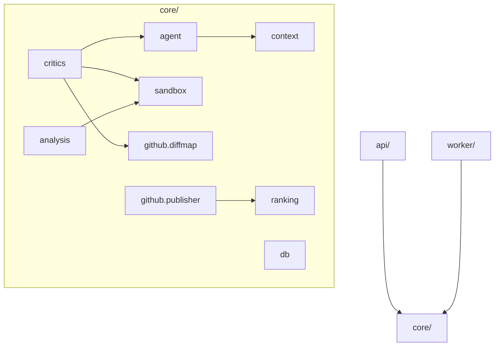
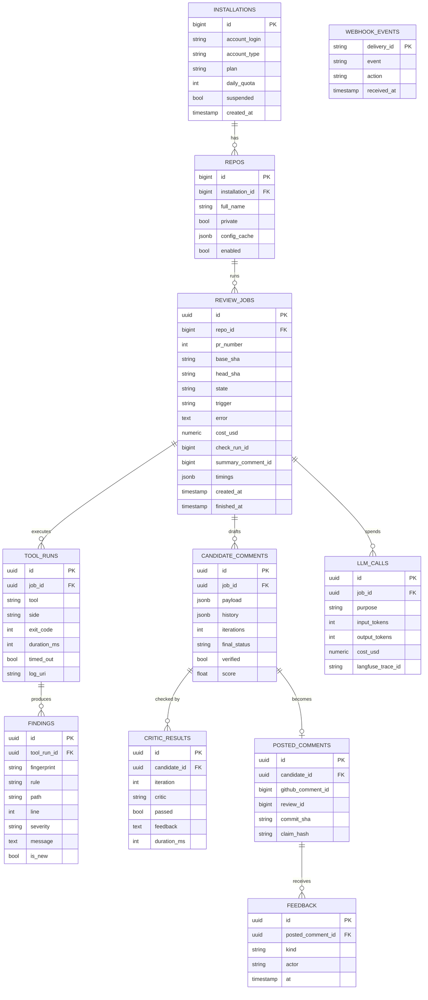
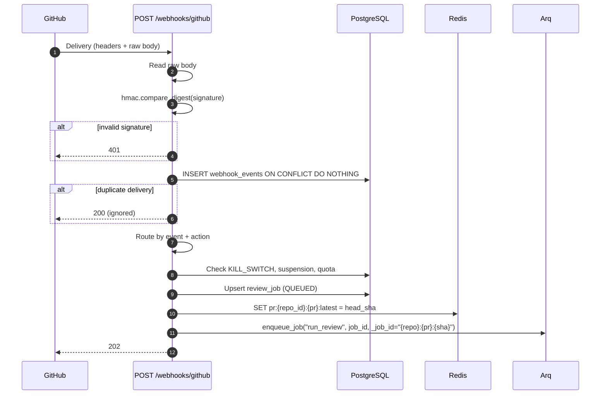
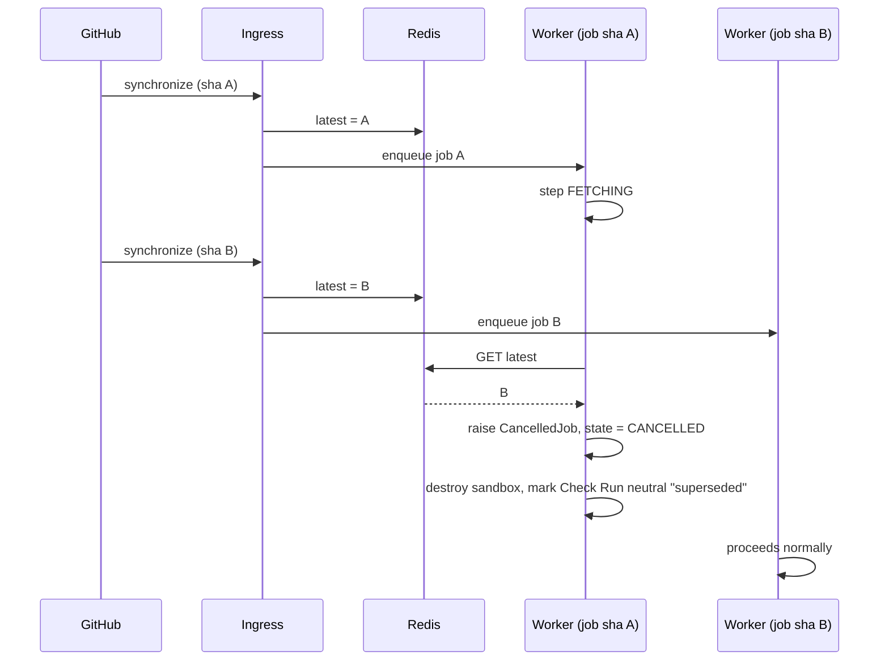
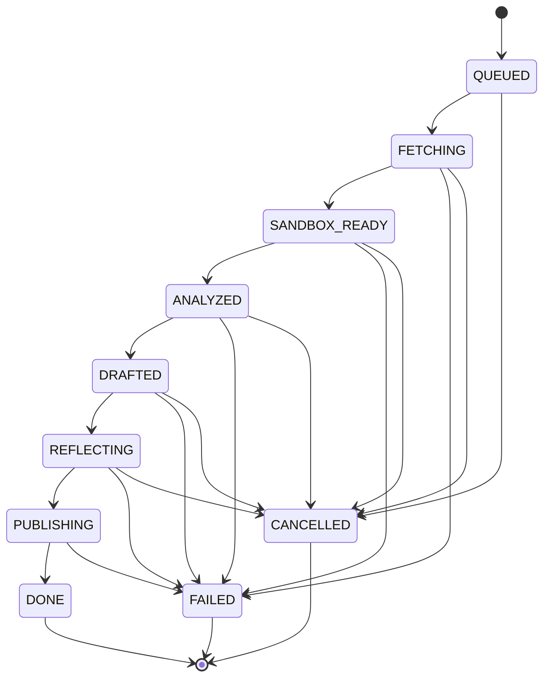
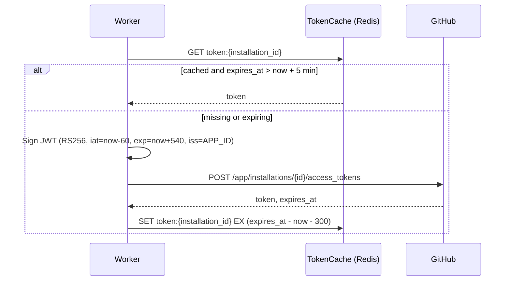
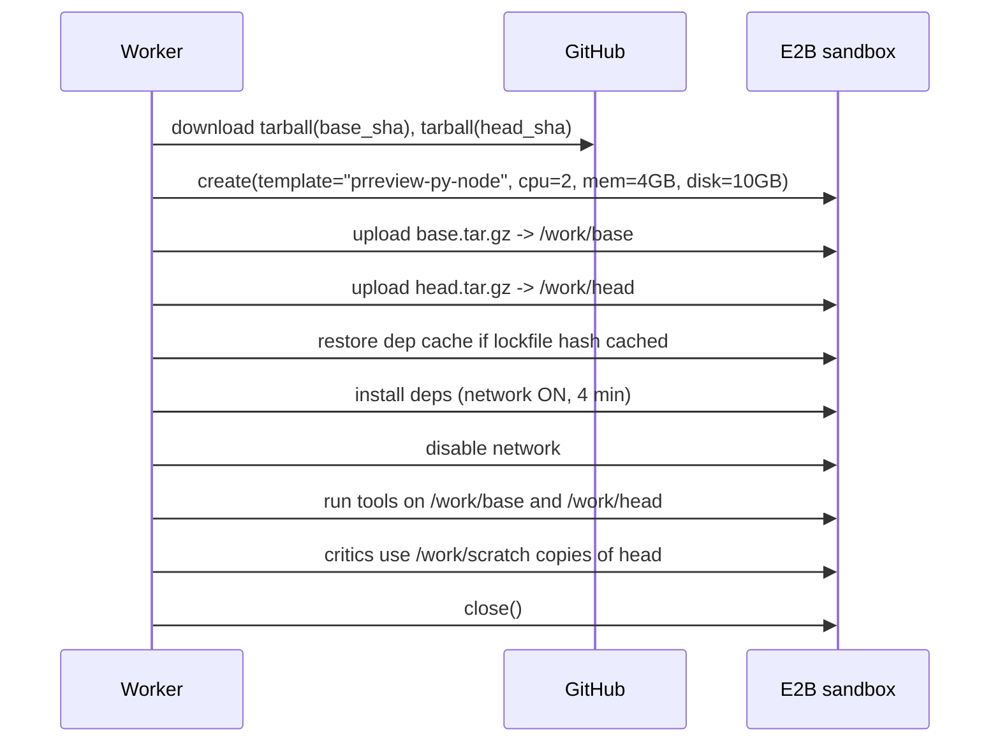
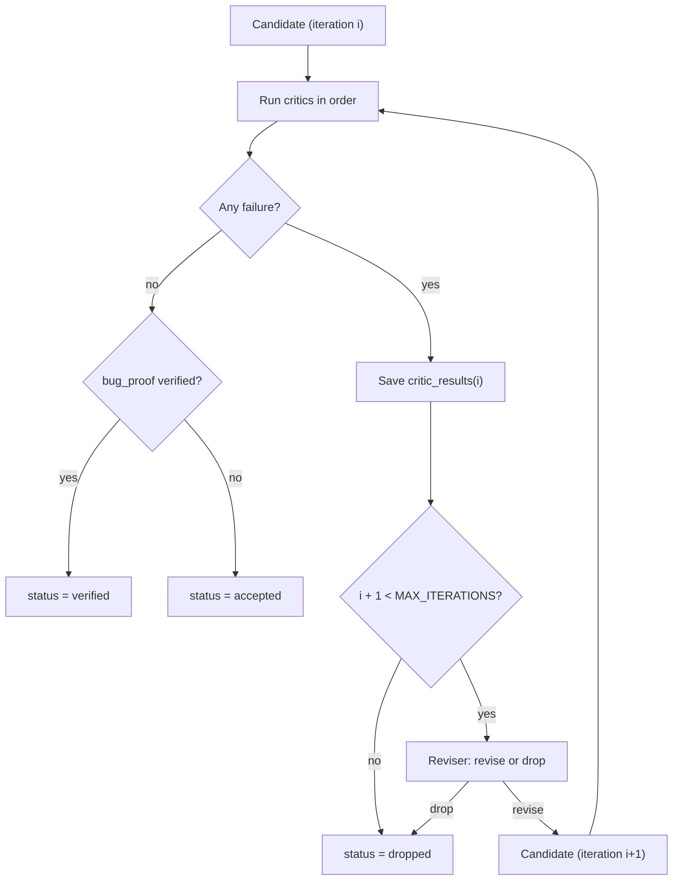
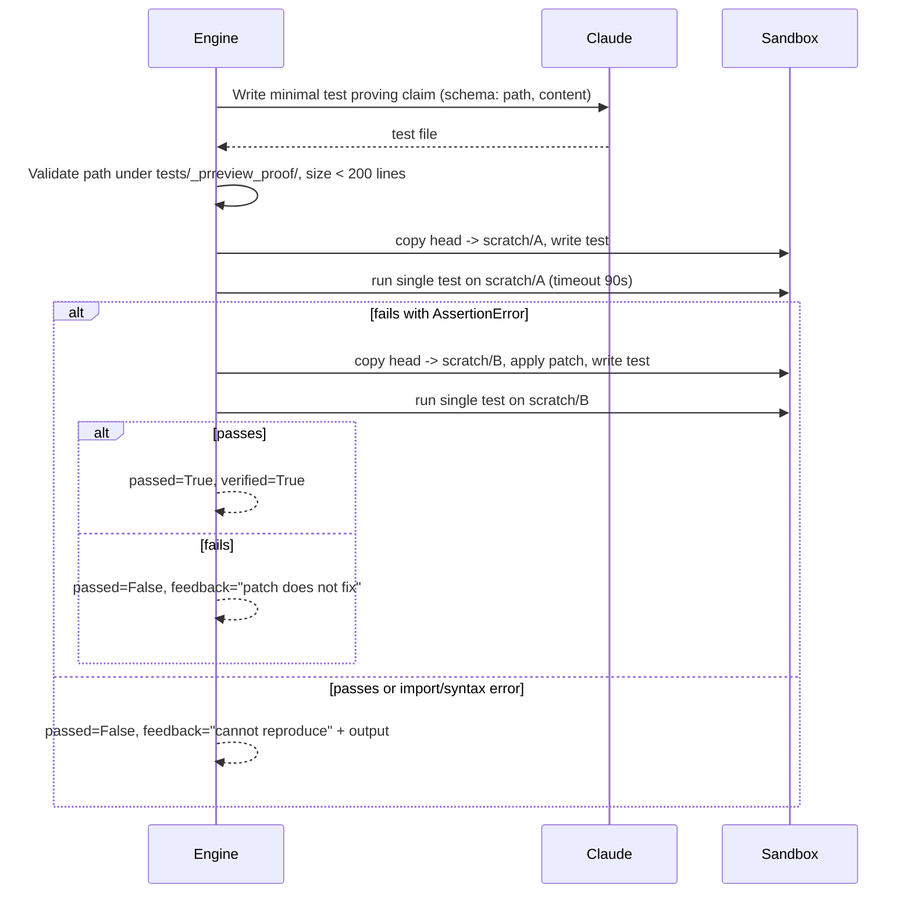
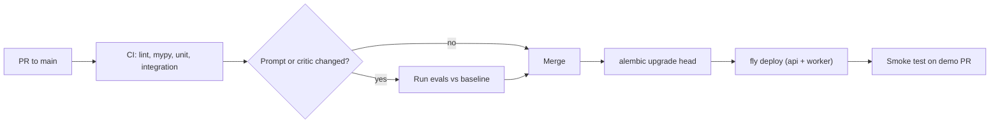

# Low-Level Design: PR Review Agent (GitHub App)

| Field     | Value                                                                                           |
| --------- | ----------------------------------------------------------------------------------------------- |
| Document  | Low-Level Design (LLD)                                                                          |
| System    | PR Review Agent                                                                                 |
| Version   | 1.0                                                                                             |
| Stack     | Python 3.12, FastAPI, Arq/Redis, SQLAlchemy 2.0 + Alembic, PostgreSQL, E2B, Claude API, Next.js |
| Companion | `HLD-pr-review-agent.md`                                                                      |

---

## 1. Scope

This document specifies modules, data structures, database schema, interfaces, algorithms, APIs, error handling, limits and testing for the PR Review Agent. It is the implementation reference; architectural rationale lives in the HLD.

---

## 2. Repository layout

```
pr-agent/
├── api/
│   ├── main.py               # create_app(), routers, middleware, OTel
│   ├── deps.py               # DB session, settings, auth dependencies
│   ├── webhooks.py           # POST /webhooks/github
│   ├── traces.py             # /api/jobs, /api/jobs/{id}, /api/jobs/{id}/candidates
│   └── stats.py              # /api/stats, /healthz, /readyz
├── worker/
│   ├── main.py               # Arq WorkerSettings
│   ├── orchestrator.py       # run_review(), state handlers, cancellation
│   └── tasks.py              # ingest_feedback(), cleanup_expired()
├── core/
│   ├── settings.py           # pydantic-settings
│   ├── errors.py             # TransientError, FatalError, CancelledJob, BudgetExceeded
│   ├── cost.py               # CostMeter
│   ├── github/
│   │   ├── app_auth.py       # JWT + installation token cache
│   │   ├── client.py         # typed wrapper over githubkit
│   │   ├── diffmap.py        # DiffMap from unidiff
│   │   ├── checks.py         # Check Run lifecycle
│   │   └── publisher.py      # review, summary comment
│   ├── sandbox/
│   │   ├── base.py           # Sandbox Protocol, ExecResult
│   │   ├── e2b.py            # E2BSandbox
│   │   └── snapshot.py       # tarball creation from git archive
│   ├── analysis/
│   │   ├── config.py         # RepoConfig
│   │   ├── detect.py         # toolchain detection
│   │   ├── runners/          # ruff.py, mypy.py, pytest.py, eslint.py, tsc.py, jest.py, semgrep.py
│   │   └── delta.py          # fingerprinting + base/head delta
│   ├── context/
│   │   ├── symbols.py        # tree-sitter extraction
│   │   ├── builder.py        # ReviewContext assembly
│   │   └── budget.py         # token counting + trimming
│   ├── agent/
│   │   ├── schemas.py        # CandidateComment, DraftResponse
│   │   ├── llm.py            # Claude client wrapper with CostMeter + retries
│   │   ├── drafter.py
│   │   ├── reviser.py
│   │   └── prompts/          # draft_bug.md, draft_security.md, draft_tests.md, revise.md, proof_test.md
│   ├── critics/
│   │   ├── base.py           # Critic Protocol, CriticResult
│   │   ├── anchor.py
│   │   ├── grounding.py
│   │   ├── patch_apply.py
│   │   ├── patch_lint.py
│   │   ├── patch_tests.py
│   │   ├── bug_proof.py
│   │   └── engine.py         # reflection loop
│   ├── ranking.py
│   └── db/
│       ├── models.py
│       ├── session.py
│       └── repo.py           # data access functions
├── migrations/               # Alembic
├── evals/
│   ├── dataset.yaml
│   ├── run_evals.py
│   └── report.py
├── web/                      # Next.js
├── tests/
│   ├── unit/
│   ├── integration/
│   └── fixtures/             # recorded GitHub payloads, sample diffs
├── Dockerfile
├── fly.toml
└── pyproject.toml
```

### 2.1 Module dependency rules



- `api/` and `worker/` contain wiring only; all logic is in `core/`.
- `core/` never imports from `api/` or `worker/`.
- `core/db` is the only module that imports SQLAlchemy models.

---

## 3. Configuration

All configuration is loaded by `core/settings.py` (`pydantic-settings`) from environment variables.

| Variable                       | Type       | Default           | Description                         |
| ------------------------------ | ---------- | ----------------- | ----------------------------------- |
| `GITHUB_APP_ID`              | int        | —                | GitHub App ID                       |
| `GITHUB_PRIVATE_KEY`         | secret str | —                | PEM private key                     |
| `GITHUB_WEBHOOK_SECRET`      | secret str | —                | HMAC secret                         |
| `BOT_LOGIN`                  | str        | `prreview[bot]` | Bot username for self-detection     |
| `DATABASE_URL`               | str        | —                | `postgresql+asyncpg://...`        |
| `REDIS_URL`                  | str        | —                | Redis connection URL                |
| `ANTHROPIC_API_KEY`          | secret str | —                | Claude API key                      |
| `CLAUDE_MODEL`               | str        | —                | Model ID for drafting/revision      |
| `E2B_API_KEY`                | secret str | —                | Sandbox provider key                |
| `S3_BUCKET`, `S3_ENDPOINT` | str        | —                | Log storage                         |
| `LANGFUSE_*`                 | str        | —                | LLM tracing                         |
| `MAX_ITERATIONS`             | int        | 3                 | Reflection iterations per candidate |
| `MAX_COMMENTS`               | int        | 7                 | Inline comment cap                  |
| `JOB_BUDGET_USD`             | Decimal    | 0.50              | Per-job LLM spend cap               |
| `DAILY_BUDGET_USD`           | Decimal    | 20.00             | Global daily cap                    |
| `INSTALL_DAILY_QUOTA`        | int        | 30                | Jobs per installation per day       |
| `WORKER_CONCURRENCY`         | int        | 4                 | Concurrent jobs per worker          |
| `KILL_SWITCH`                | bool       | false             | Reject all new jobs                 |
| `DEMO_REPOS`                 | list[str]  | []                | Repos with public traces            |

---

## 4. Data model

### 4.1 Entity relationship diagram



### 4.2 Enumerations

| Column                              | Values                                                                                                                                      |
| ----------------------------------- | ------------------------------------------------------------------------------------------------------------------------------------------- |
| `review_jobs.state`               | `QUEUED`, `FETCHING`, `SANDBOX_READY`, `ANALYZED`, `DRAFTED`, `REFLECTING`, `PUBLISHING`, `DONE`, `FAILED`, `CANCELLED` |
| `review_jobs.trigger`             | `opened`, `synchronize`, `reopened`, `ready_for_review`, `command`                                                                |
| `tool_runs.side`                  | `base`, `head`                                                                                                                          |
| `candidate_comments.final_status` | `pending`, `accepted`, `verified`, `downgraded`, `dropped`                                                                        |
| `feedback.kind`                   | `thumbs_up`, `thumbs_down`, `resolved`, `suggestion_committed`, `replied`                                                         |
| `llm_calls.purpose`               | `draft`, `revise`, `proof_test`, `summary`                                                                                          |

### 4.3 Indexes and constraints

| Table               | Index / constraint                                           | Purpose                    |
| ------------------- | ------------------------------------------------------------ | -------------------------- |
| `review_jobs`     | `UNIQUE (repo_id, pr_number, head_sha)`                    | Idempotent job creation    |
| `review_jobs`     | `(repo_id, pr_number, created_at DESC)`                    | Latest job per PR          |
| `review_jobs`     | `(state) WHERE state NOT IN ('DONE','FAILED','CANCELLED')` | Stuck job sweeper          |
| `findings`        | `(tool_run_id, is_new)`                                    | Fetch new findings per job |
| `critic_results`  | `(candidate_id, iteration)`                                | Trace viewer               |
| `posted_comments` | `UNIQUE (github_comment_id)`                               | Map feedback events        |
| `posted_comments` | `(claim_hash)`                                             | Cross-push dedupe          |
| `webhook_events`  | PK `delivery_id`                                           | Delivery dedupe            |

---

## 5. Webhook ingress

### 5.1 Handler sequence



### 5.2 Event routing

| Event                           | Action                                                          | Handling                                               |
| ------------------------------- | --------------------------------------------------------------- | ------------------------------------------------------ |
| `pull_request`                | `opened`, `synchronize`, `reopened`, `ready_for_review` | Create review job (skip drafts, skip if author is bot) |
| `pull_request`                | `closed`                                                      | Cancel in-flight jobs for the PR                       |
| `issue_comment`               | `created` with `@prreview review`                           | Create job with `trigger=command`                    |
| `issue_comment`               | `created` with `@prreview explain` in review thread         | Enqueue `explain` task                               |
| `pull_request_review_comment` | reply on bot comment                                            | Record `feedback.kind=replied`                       |
| `installation`                | `created`, `deleted`, `suspend`, `unsuspend`            | Upsert installation                                    |
| `installation_repositories`   | `added`, `removed`                                          | Upsert or disable repos                                |

Reactions are not delivered as webhooks; a scheduled `ingest_feedback` task polls reactions on recent bot comments (section 15).

### 5.3 Signature verification

```python
def verify_signature(secret: bytes, body: bytes, header: str | None) -> bool:
    if not header or not header.startswith("sha256="):
        return False
    expected = hmac.new(secret, body, hashlib.sha256).hexdigest()
    return hmac.compare_digest(expected, header.removeprefix("sha256="))
```

---

## 6. Queue and worker

### 6.1 Arq configuration

```python
class WorkerSettings:
    functions = [run_review, explain_comment]
    cron_jobs = [cron(ingest_feedback, minute={0, 15, 30, 45}),
                 cron(sweep_stuck_jobs, minute=set(range(0, 60, 5))),
                 cron(cleanup_expired, hour=3, minute=0)]
    redis_settings = RedisSettings.from_dsn(settings.redis_url)
    max_jobs = settings.worker_concurrency
    job_timeout = 15 * 60
    max_tries = 3
    keep_result = 3600
```

### 6.2 Superseding pushes



### 6.3 Stuck job sweeper

Every 5 minutes: jobs in a non-terminal state with `updated_at` older than 20 minutes are re-enqueued once (resume from persisted state), or marked `FAILED` with `error="stuck"` if already retried.

---

## 7. Orchestrator

### 7.1 State machine



`PUBLISHING` cannot be cancelled; once publishing starts it completes, to avoid a half-posted review.

### 7.2 Step contracts

| State (on entry)  | Handler             | Reads                        | Writes                                          | Next              |
| ----------------- | ------------------- | ---------------------------- | ----------------------------------------------- | ----------------- |
| `QUEUED`        | `start`           | job                          | Check Run (`in_progress`), `check_run_id`   | `FETCHING`      |
| `FETCHING`      | `fetch`           | GitHub PR, diff, base config | `ReviewInput` blob in S3, `config_cache`    | `SANDBOX_READY` |
| `SANDBOX_READY` | `prepare_sandbox` | snapshots, RepoConfig        | sandbox ID in job context                       | `ANALYZED`      |
| `ANALYZED`      | `analyze`         | sandbox                      | `tool_runs`, `findings` (`is_new`)        | `DRAFTED`       |
| `DRAFTED`       | `draft`           | context                      | `candidate_comments` (`pending`)            | `REFLECTING`    |
| `REFLECTING`    | `reflect`         | candidates, sandbox          | `critic_results`, candidate status            | `PUBLISHING`    |
| `PUBLISHING`    | `publish`         | accepted candidates          | review, `posted_comments`, summary, Check Run | `DONE`          |

If a worker resumes at `ANALYZED` or later, the sandbox is recreated from snapshots (sandboxes are not persisted across worker restarts).

### 7.3 Run loop

```python
async def run_review(ctx: dict, job_id: UUID) -> None:
    job = await repo.get_job(job_id)
    runtime = JobRuntime(job=job, cost=CostMeter(settings.job_budget_usd))
    try:
        while job.state not in TERMINAL:
            if job.state != State.PUBLISHING:
                await ensure_not_superseded(job)
            handler = HANDLERS[job.state]
            next_state = await with_retries(handler, runtime)
            await repo.advance(job, next_state, runtime.pending_writes)
    except CancelledJob:
        await repo.advance(job, State.CANCELLED)
        await checks.complete(job, conclusion="neutral", title="Superseded by a newer push")
    except BudgetExceeded:
        await publish_partial(runtime)
    except FatalError as e:
        await repo.fail(job, str(e))
        await checks.complete(job, conclusion="neutral", title="Review could not complete", summary=e.user_message)
    finally:
        await runtime.close_sandbox()
```

`repo.advance` writes the new state and the step outputs in **one transaction**.

### 7.4 Error classes

| Exception          | Raised for                                                                                          | Handling                                                       |
| ------------------ | --------------------------------------------------------------------------------------------------- | -------------------------------------------------------------- |
| `TransientError` | GitHub 5xx/secondary rate limit, Claude 429/5xx/overloaded, sandbox create failure, network timeout | Retry: 2s, 8s, 30s (+ jitter), then escalate to `FatalError` |
| `FatalError`     | 404 PR, auth revoked, invalid repo config, unrecoverable sandbox error                              | Job `FAILED`, Check Run neutral with reason                  |
| `CancelledJob`   | Newer head SHA, PR closed                                                                           | Job `CANCELLED`                                              |
| `BudgetExceeded` | `CostMeter` over cap                                                                              | Publish accepted comments so far, note in summary              |

---

## 8. GitHub integration

### 8.1 App authentication



Tokens are never logged; the Redis value is encrypted with a key held in settings.

### 8.2 Client wrapper

`core/github/client.py` exposes typed, retrying methods:

| Method                                                | GitHub endpoint                                                               |
| ----------------------------------------------------- | ----------------------------------------------------------------------------- |
| `get_pull(repo, n)`                                 | `GET /repos/{o}/{r}/pulls/{n}`                                              |
| `get_diff(repo, n)`                                 | `GET /repos/{o}/{r}/pulls/{n}` with `Accept: application/vnd.github.diff` |
| `list_files(repo, n)`                               | `GET /repos/{o}/{r}/pulls/{n}/files` (paginated)                            |
| `get_file(repo, path, ref)`                         | `GET /repos/{o}/{r}/contents/{path}?ref=`                                   |
| `download_tarball(repo, ref)`                       | `GET /repos/{o}/{r}/tarball/{ref}`                                          |
| `create_review(...)`                                | `POST /repos/{o}/{r}/pulls/{n}/reviews`                                     |
| `list_review_comments(...)`                         | `GET /repos/{o}/{r}/pulls/{n}/comments`                                     |
| `create_check_run(...)` / `update_check_run(...)` | `POST/PATCH /repos/{o}/{r}/check-runs`                                      |
| `upsert_issue_comment(...)`                         | `GET/POST/PATCH /repos/{o}/{r}/issues/{n}/comments`                         |
| `list_reactions(comment_id)`                        | `GET /repos/{o}/{r}/pulls/comments/{id}/reactions`                          |

Rate limits: read `x-ratelimit-remaining`; when below 100, sleep until `x-ratelimit-reset`. Secondary rate limits (403 with `retry-after`) raise `TransientError`.

### 8.3 Diff map

```python
@dataclass(frozen=True)
class DiffMap:
    right: dict[str, set[int]]        # path -> new-side line numbers (added + context)
    left: dict[str, set[int]]         # path -> old-side line numbers (removed + context)
    added: dict[str, set[int]]        # path -> added lines only
    renamed: dict[str, str]           # new path -> old path

    def commentable(self, path: str, line: int, side: str) -> bool: ...
    def nearest(self, path: str, line: int, side: str, radius: int = 3) -> int | None: ...
```

Built with `unidiff.PatchSet`. Binary files and files over 5,000 changed lines are excluded.

---

## 9. Sandbox

### 9.1 Interface

```python
@dataclass
class ExecResult:
    exit_code: int
    stdout: str
    stderr: str
    duration_ms: int
    timed_out: bool

class Sandbox(Protocol):
    async def upload_tree(self, tar_gz: bytes, dest: str) -> None: ...
    async def exec(self, cmd: list[str], cwd: str, timeout_s: int,
                   network: bool = False, env: dict[str, str] | None = None) -> ExecResult: ...
    async def read_file(self, path: str) -> bytes: ...
    async def write_file(self, path: str, data: bytes) -> None: ...
    async def close(self) -> None: ...
```

### 9.2 Lifecycle



### 9.3 Workspace layout inside sandbox

| Path                             | Contents                                        |
| -------------------------------- | ----------------------------------------------- |
| `/work/base`                   | Base commit snapshot                            |
| `/work/head`                   | Head commit snapshot (never modified)           |
| `/work/scratch/{candidate_id}` | Copy of head per critic run, patch applied here |
| `/work/out`                    | JSON/SARIF/JUnit outputs                        |
| `/cache/deps`                  | Restored dependency cache                       |

### 9.4 Isolation rules

- No environment variables from the worker are passed except `CI=true`, `PYTHONDONTWRITEBYTECODE=1`, `NODE_ENV=test`.
- Network is enabled only for the install command, with an egress allowlist (`pypi.org`, `files.pythonhosted.org`, `registry.npmjs.org`) where the provider supports it.
- Every `exec` has a timeout; the sandbox has a hard lifetime of 15 minutes.
- Output capture is truncated at 1 MB per stream; full logs go to S3.

---

## 10. Analysis

### 10.1 Repo configuration

Read from the **base** branch (`.prreview.yml`). Missing file → defaults from detection.

```python
class RepoConfig(BaseModel):
    language: Literal["python", "typescript", "auto"] = "auto"
    install: list[str] | None = None
    lint: list[Literal["ruff", "mypy", "eslint", "tsc", "semgrep"]] | None = None
    test: list[str] | None = None
    test_timeout_s: int = Field(360, le=600)
    ignore_paths: list[str] = ["**/migrations/**", "**/*.lock", "**/dist/**", "**/vendor/**"]
    max_comments: int = Field(7, ge=1, le=15)
    categories: set[str] = {"bug", "security", "test_gap", "perf"}
    proof_tests: bool = True
```

### 10.2 Toolchain detection

| Signal file           | Language | Install                             | Lint/types                 | Tests          |
| --------------------- | -------- | ----------------------------------- | -------------------------- | -------------- |
| `uv.lock`           | Python   | `uv sync --frozen`                | ruff, mypy (if configured) | pytest         |
| `poetry.lock`       | Python   | `poetry install --no-interaction` | ruff, mypy                 | pytest         |
| `requirements*.txt` | Python   | `pip install -r ...`              | ruff, mypy                 | pytest         |
| `pnpm-lock.yaml`    | TS/JS    | `pnpm install --frozen-lockfile`  | eslint, tsc                | vitest or jest |
| `package-lock.json` | TS/JS    | `npm ci`                          | eslint, tsc                | vitest or jest |
| always                | any      | —                                  | semgrep (`p/default`)    | —             |

mypy runs only if a mypy config exists; tsc only if `tsconfig.json` exists. Test framework is chosen from `package.json` devDependencies or `pytest` presence.

### 10.3 Runners

| Tool        | Command (cwd = side root)                                                      | Output parsed                               |
| ----------- | ------------------------------------------------------------------------------ | ------------------------------------------- |
| ruff        | `ruff check --output-format json .`                                          | JSON array                                  |
| mypy        | `mypy . --output json` (fallback: parse `file:line: error:`)               | JSON lines                                  |
| semgrep     | `semgrep --config p/default --sarif --metrics off .`                         | SARIF                                       |
| eslint      | `npx eslint -f json .`                                                       | JSON                                        |
| tsc         | `npx tsc --noEmit --pretty false`                                            | Regex `file(line,col): error TSxxxx: msg` |
| pytest      | `pytest -q --junitxml=/work/out/{side}-junit.xml`                            | JUnit XML                                   |
| vitest/jest | `npx vitest run --reporter=junit` / `npx jest --ci --reporters=jest-junit` | JUnit XML                                   |

All parse into:

```python
class Finding(BaseModel):
    tool: str
    rule: str
    path: str
    line: int
    end_line: int | None = None
    severity: Literal["error", "warning", "info"]
    message: str
    fingerprint: str = ""

class TestResult(BaseModel):
    test_id: str          # "tests/test_x.py::test_y"
    outcome: Literal["passed", "failed", "error", "skipped"]
    message: str | None = None
```

### 10.4 Delta algorithm

```python
def fingerprint(f: Finding) -> str:
    msg = re.sub(r"\d+", "N", f.message.strip().lower())
    return sha1(f"{f.tool}|{f.rule}|{f.path}|{msg}".encode()).hexdigest()

def finding_delta(base: list[Finding], head: list[Finding], diff: DiffMap) -> list[Finding]:
    base_counts = Counter(fingerprint(f) for f in base)
    new = []
    for f in head:
        fp = fingerprint(f)
        if base_counts[fp] > 0:
            base_counts[fp] -= 1
            continue
        if f.line in diff.added.get(f.path, set()):
            new.append(f.model_copy(update={"fingerprint": fp}))
    return new

def test_delta(base: list[TestResult], head: list[TestResult]) -> list[TestResult]:
    base_ok = {t.test_id for t in base if t.outcome == "passed"}
    return [t for t in head if t.outcome in ("failed", "error") and t.test_id in base_ok]
```

Using a counter (not a set) handles repeated identical findings correctly. Renamed files are matched through `DiffMap.renamed`.

---

## 11. Context builder

### 11.1 ReviewContext

```python
class ReviewContext(BaseModel):
    pr_title: str
    pr_body: str
    diff_hunks: list[Hunk]
    files: dict[str, str]                 # full text of small changed files (< 400 lines)
    symbols: list[SymbolSnippet]          # definitions of touched symbols
    callers: list[SymbolSnippet]          # call sites of changed functions
    new_findings: list[Finding]
    newly_failing_tests: list[TestResult]
    config: RepoConfig
```

### 11.2 Assembly algorithm

1. Parse changed files at head with tree-sitter; collect functions/classes whose span overlaps added lines → **touched symbols**.
2. For each touched symbol, find references across the repo (tree-sitter identifier query + ripgrep fallback), take up to 5 callers.
3. Collect identifiers used in added lines that are defined elsewhere in the repo → **dependency definitions**.
4. Rank items by priority:

| Priority | Item                                                         |
| -------- | ------------------------------------------------------------ |
| 1        | Diff hunks (always included)                                 |
| 2        | Newly failing tests with output (truncated to 60 lines each) |
| 3        | New findings                                                 |
| 4        | Touched symbol full bodies                                   |
| 5        | Dependency definitions                                       |
| 6        | Callers                                                      |
| 7        | Full small changed files                                     |
| 8        | PR body (truncated to 2,000 chars)                           |

5. Add items in priority order until the token budget (default 60k input tokens) is reached; drop lowest priority first.

All untrusted text is wrapped in delimiters such as `<untrusted_pr_body>...</untrusted_pr_body>`, and the system prompt states that text inside these tags is data, never instructions.

---

## 12. Agent

### 12.1 Output schemas

```python
class CandidateComment(BaseModel):
    path: str
    line: int
    side: Literal["LEFT", "RIGHT"] = "RIGHT"
    start_line: int | None = None
    category: Literal["bug", "security", "perf", "test_gap", "style"]
    severity: Literal["high", "medium", "low"]
    claim: str = Field(max_length=200)
    body: str = Field(max_length=2000)
    suggested_patch: str | None = None       # unified diff against head
    evidence_needed: Literal["repro_test", "lint", "none"]
    confidence: float = Field(ge=0.0, le=1.0)

class DraftResponse(BaseModel):
    comments: list[CandidateComment] = Field(max_length=15)

class ReviseResponse(BaseModel):
    action: Literal["revise", "drop"]
    comment: CandidateComment | None = None
    reason: str
```

### 12.2 LLM wrapper

```python
class LLM:
    async def structured(self, purpose: str, system: str, user: str,
                         schema: type[T], meter: CostMeter, max_tokens: int = 4000) -> T:
        # 1. meter.check() before the call
        # 2. call Claude; record tokens + cost in llm_calls and meter
        # 3. strip code fences, json.loads, schema.model_validate
        # 4. on ValidationError: one retry with the error appended
        # 5. on second failure: raise FatalError for this call only (caller decides)
```

### 12.3 Drafting

- One call per enabled category group: `bug + perf`, `security`, `test_gap`. Calls run concurrently.
- Each prompt includes the category definition, examples of good and bad comments, the comment schema, and the rule: *"Only comment on lines that were added or modified. If unsure, do not comment."*
- Results merged; comments with `confidence < 0.4` discarded before critics.

### 12.4 Revision

Input: the original candidate, the failing critic results (name + feedback), and relevant context. Output: `ReviseResponse`. A `drop` ends the candidate's loop.

---

## 13. Critics

### 13.1 Interface

```python
class CriticResult(BaseModel):
    critic: str
    passed: bool
    feedback: str = ""
    verified: bool = False
    duration_ms: int = 0

class Critic(Protocol):
    name: str
    order: int
    needs_sandbox: bool
    def applies(self, c: CandidateComment) -> bool: ...
    async def check(self, c: CandidateComment, rt: JobRuntime) -> CriticResult: ...
```

### 13.2 Critic specifications

| Order | Critic                | Applies to                                                                      | Pass condition                                                                                                 | Feedback on failure                                           |
| ----- | --------------------- | ------------------------------------------------------------------------------- | -------------------------------------------------------------------------------------------------------------- | ------------------------------------------------------------- |
| 10    | `anchor`            | all                                                                             | `diff.commentable(path, line, side)`; if not, `nearest()` within 3 lines is auto-applied and passes        | "Line N is not in the diff. Commentable lines near it: …"    |
| 20    | `grounding`         | all                                                                             | Every backticked identifier in `claim`/`body` exists in repo symbol index or diff                          | "Identifier `foo_bar` does not exist. Similar: `foo_baz`" |
| 30    | `duplicate_finding` | all                                                                             | Not equivalent to a linter finding on same path within ±2 lines                                               | "Already reported by ruff E711"                               |
| 40    | `patch_apply`       | has patch                                                                       | `git apply --check` succeeds in scratch copy                                                                 | stderr of `git apply`                                       |
| 50    | `patch_lint`        | has patch                                                                       | Linters/type checkers on patched files produce no findings absent before patch                                 | New findings list                                             |
| 60    | `patch_tests`       | has patch                                                                       | All tests passing on head still pass with patch (scoped to test files importing changed modules when possible) | Names + output of broken tests                                |
| 70    | `bug_proof`         | `category=bug` and `evidence_needed=repro_test` and `proof_tests` enabled | Generated test fails on head with assertion error and passes with patch                                        | Head/patched run output                                       |

### 13.3 Reflection engine



```python
async def reflect(candidates: list[Candidate], rt: JobRuntime) -> None:
    sem = asyncio.Semaphore(3)                       # parallel candidates per sandbox
    async def one(c: Candidate):
        async with sem:
            for i in range(settings.max_iterations):
                results = []
                for critic in ordered_critics(c.comment):
                    r = await critic.check(c.comment, rt)
                    results.append(r)
                    if not r.passed:
                        break                         # short-circuit
                await rt.save_critic_results(c, i, results)
                if all(r.passed for r in results):
                    c.status = "verified" if any(r.verified for r in results) else "accepted"
                    return
                rev = await reviser.revise(c.comment, [r for r in results if not r.passed], rt)
                if rev.action == "drop":
                    break
                c.history.append(c.comment); c.comment = rev.comment
            c.status = "dropped"
    await asyncio.gather(*(one(c) for c in candidates))
```

### 13.4 Bug-proof critic



Outcome mapping:

| Head run            | Patched run | Result                                                                             |
| ------------------- | ----------- | ---------------------------------------------------------------------------------- |
| Assertion failure   | Pass        | `verified`                                                                       |
| Assertion failure   | Fail        | Revise patch                                                                       |
| Pass                | —          | Downgrade to "possible issue" (severity −1) or drop if severity becomes below low |
| Import/syntax error | —          | Revise test once, then downgrade                                                   |

---

## 14. Ranking

```python
SEV = {"high": 2.0, "medium": 1.0, "low": 0.0}

def score(c: Candidate) -> float:
    return 3.0 * (c.status == "verified") + SEV[c.comment.severity] + c.comment.confidence

def select(cands: list[Candidate], posted_hashes: set[str], cap: int) -> list[Candidate]:
    ok = [c for c in cands if c.status in ("accepted", "verified")]
    ok = [c for c in ok if claim_hash(c) not in posted_hashes]
    ok.sort(key=score, reverse=True)
    kept: list[Candidate] = []
    for c in ok:
        if any(k.comment.path == c.comment.path and abs(k.comment.line - c.comment.line) <= 3 for k in kept):
            continue
        kept.append(c)
    return kept[:cap]
```

`claim_hash` = SHA-1 of `path + normalized claim`, used to avoid re-posting the same issue on later pushes.

---

## 15. Publishing and feedback

### 15.1 Review payload

```json
{
  "commit_id": "<head_sha>",
  "event": "COMMENT",
  "body": "",
  "comments": [
    {
      "path": "app/billing.py",
      "line": 42,
      "side": "RIGHT",
      "body": "**✅ Verified bug · high**\n\n`apply_discount` returns a negative total when ...\n\n```suggestion\n    return max(total - discount, 0)\n```\n\n<details><summary>Proof test</summary>\n\n...\n</details>\n\n<!-- prreview:c:<candidate_id> -->"
    }
  ]
}
```

### 15.2 Suggestion block rule

A patch becomes a `suggestion` block only if all hunks fall within `[start_line, line]` of the comment on a single file. Otherwise the patch is shown as a fenced `diff` block.

### 15.3 Publish algorithm

1. Build comments for selected candidates.
2. `POST` review. On `422` with an anchor error, remove the offending comment (identified by index from the error, or by re-validating with `DiffMap`), retry up to 2 times.
3. Store `posted_comments` rows with `github_comment_id` fetched via `GET reviews/{id}/comments`.
4. Upsert summary comment: find an issue comment by the bot containing `<!-- prreview:summary -->`; `PATCH` if found, else `POST`.
5. Complete Check Run.

### 15.4 Summary comment template

```markdown
<!-- prreview:summary -->
### PR review · `abc1234`
**3 comments** (1 verified) · tests: 1 newly failing · lint: 2 new issues

| | Issue | File |
|---|---|---|
| ✅ | Negative total on large discounts | `app/billing.py:42` |
| ⚠️ | Missing await on `send_email` | `app/notify.py:18` |
| 🧪 | No test for empty cart | `app/cart.py:77` |

<details><summary>Tool results</summary> ... </details>

[View full trace](https://<dashboard>/jobs/<job_id>)
```

### 15.5 Check Run

| Phase               | Status          | Conclusion  | Title                    |
| ------------------- | --------------- | ----------- | ------------------------ |
| Start               | `in_progress` | —          | "Reviewing…"            |
| Success, no issues  | `completed`   | `success` | "No issues found"        |
| Success, issues     | `completed`   | `neutral` | "3 comments, 1 verified" |
| Failed / superseded | `completed`   | `neutral` | Reason                   |

`neutral` is used instead of `failure` so the bot never blocks merging.

### 15.6 Feedback ingestion

Cron every 15 minutes, for comments posted in the last 14 days:

| Signal               | Source                                                  | Stored as                       |
| -------------------- | ------------------------------------------------------- | ------------------------------- |
| 👍 / 👎 reactions    | Reactions API                                           | `thumbs_up` / `thumbs_down` |
| Thread resolved      | GraphQL `reviewThreads.isResolved`                    | `resolved`                    |
| Suggestion committed | Later commit diff contains suggested lines at that path | `suggestion_committed`        |
| Human reply          | `pull_request_review_comment` webhook                 | `replied`                     |

Acceptance rate = comments with any of {thumbs_up, resolved, suggestion_committed} / posted comments.

---

## 16. Internal API

| Method | Path                           | Auth                                          | Response                        |
| ------ | ------------------------------ | --------------------------------------------- | ------------------------------- |
| POST   | `/webhooks/github`           | HMAC                                          | `202` / `200` / `401`     |
| GET    | `/api/jobs?repo=&pr=&limit=` | Public for demo repos; GitHub OAuth otherwise | `JobSummary[]`                |
| GET    | `/api/jobs/{id}`             | same                                          | `JobDetail`                   |
| GET    | `/api/jobs/{id}/candidates`  | same                                          | `CandidateTrace[]`            |
| GET    | `/api/stats`                 | Public                                        | `Stats`                       |
| GET    | `/healthz`                   | None                                          | `200` if process alive        |
| GET    | `/readyz`                    | None                                          | `200` if DB + Redis reachable |

### 16.1 Example: `GET /api/jobs/{id}/candidates`

```json
[
  {
    "id": "6f1c...",
    "final_status": "verified",
    "score": 5.9,
    "iterations": [
      {
        "n": 0,
        "comment": {"path": "app/billing.py", "line": 41, "claim": "..."},
        "critics": [
          {"critic": "anchor", "passed": true, "feedback": "re-anchored 41 -> 42"},
          {"critic": "grounding", "passed": true},
          {"critic": "patch_apply", "passed": false, "feedback": "error: patch failed: app/billing.py:40"}
        ]
      },
      {
        "n": 1,
        "comment": {"path": "app/billing.py", "line": 42, "claim": "..."},
        "critics": [
          {"critic": "patch_apply", "passed": true},
          {"critic": "patch_lint", "passed": true},
          {"critic": "patch_tests", "passed": true},
          {"critic": "bug_proof", "passed": true, "verified": true}
        ]
      }
    ]
  }
]
```

---

## 17. Limits and timeouts

| Limit                          | Value  | On exceed                                                    |
| ------------------------------ | ------ | ------------------------------------------------------------ |
| Changed lines reviewed         | 1,500  | Review first 1,500 by file priority; note in summary         |
| Changed files reviewed         | 50     | Same                                                         |
| Dependency install             | 4 min  | Skip tests; lint-only review                                 |
| Tools per side                 | 6 min  | Mark tool as timed out                                       |
| Single critic exec             | 90 s   | Critic fails with "timeout" feedback                         |
| Job wall clock                 | 15 min | `FatalError("timeout")` after publishing accepted comments |
| LLM spend per job              | $0.50  | `BudgetExceeded` → partial publish                        |
| Global daily spend             | $20    | New jobs rejected with Check Run explanation                 |
| Jobs per installation per day  | 30     | Check Run neutral "daily limit reached"                      |
| Candidates entering reflection | 15     | Lowest-confidence dropped                                    |

---

## 18. Observability

### 18.1 Spans

```
review_job (job_id, repo, pr, head_sha)
├── step.fetch
├── step.prepare_sandbox
│   └── sandbox.install
├── step.analyze
│   ├── tool.ruff (side=base|head)
│   ├── tool.pytest (side=base|head)
│   └── ...
├── step.draft
│   └── llm.call (purpose=draft, tokens, cost)
├── step.reflect
│   └── candidate (id)
│       ├── critic.anchor
│       ├── critic.patch_tests
│       └── llm.call (purpose=revise)
└── step.publish
```

### 18.2 Metrics

| Metric                             | Type      | Labels                     |
| ---------------------------------- | --------- | -------------------------- |
| `prreview_jobs_total`            | counter   | `state`                  |
| `prreview_step_duration_seconds` | histogram | `step`                   |
| `prreview_critic_results_total`  | counter   | `critic`, `passed`     |
| `prreview_comments_posted_total` | counter   | `category`, `verified` |
| `prreview_job_cost_usd`          | histogram | —                         |
| `prreview_queue_depth`           | gauge     | —                         |
| `prreview_feedback_total`        | counter   | `kind`                   |

---

## 19. Testing strategy

| Level       | Scope                                                                                                          | Tooling                                                 |
| ----------- | -------------------------------------------------------------------------------------------------------------- | ------------------------------------------------------- |
| Unit        | DiffMap, fingerprinting, delta, ranking, config parsing, signature verification, each critic with fake sandbox | pytest, hypothesis for diff parsing                     |
| Contract    | LLM output schemas against recorded responses                                                                  | pytest + stored JSON                                    |
| Integration | Webhook → job → publish with recorded GitHub API (respx) and fake LLM                                        | pytest-asyncio, respx, testcontainers (Postgres, Redis) |
| Sandbox     | Real E2B runs on fixture repos (nightly)                                                                       | pytest marker `sandbox`                               |
| End-to-end  | Dev App on demo repo, real PR, assert review posted                                                            | GitHub Actions workflow (manual / nightly)              |
| Evals       | Precision/recall on seeded-bug dataset                                                                         | `evals/run_evals.py`                                  |

### 19.1 Eval harness

```yaml
# evals/dataset.yaml
- id: billing-negative-total
  repo: you/prreview-demo
  base: 1a2b3c
  head: 4d5e6f
  expected:
    - path: app/billing.py
      line_range: [40, 45]
      category: bug
- id: clean-refactor
  repo: you/prreview-demo
  base: 7a8b9c
  head: 0d1e2f
  expected: []          # any comment is a false positive
```

Scoring: a posted comment is a true positive if it matches an expected item's path, line range and category. Report precision, recall, verified rate, mean cost and p50/p95 latency; CI fails if precision drops more than 5 points from the main-branch baseline.

---

## 20. Deployment

### 20.1 Container

```dockerfile
FROM python:3.12-slim
RUN pip install --no-cache-dir uv
WORKDIR /app
COPY pyproject.toml uv.lock ./
RUN uv sync --frozen --no-dev
COPY . .
ENV PATH="/app/.venv/bin:$PATH"
```

### 20.2 Fly.io processes

```toml
[processes]
api = "uvicorn api.main:app --host 0.0.0.0 --port 8080 --workers 2"
worker = "arq worker.main.WorkerSettings"

[[services]]
processes = ["api"]
internal_port = 8080
  [[services.http_checks]]
  path = "/readyz"
  interval = "15s"
```

### 20.3 Release process



Migrations are backward compatible (expand, then contract in a later release) so old workers can finish in-flight jobs during deploys.
