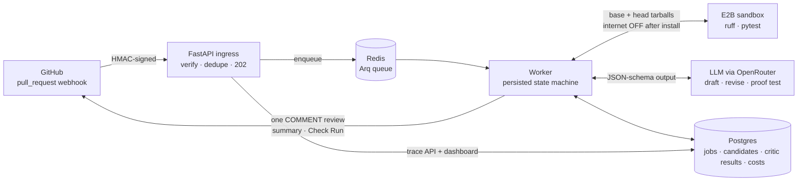
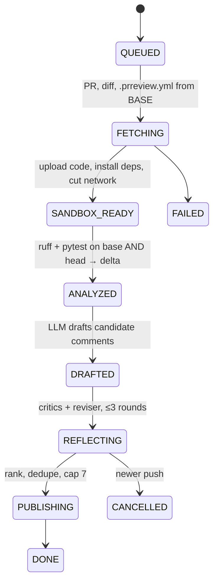
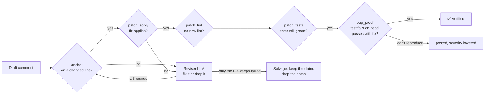

# PR Review Agent

A GitHub App that reviews pull requests **and proves its claims**. It runs the PR's code in an isolated sandbox, compares lint and test results on the base and head commits, lets an LLM draft comments, and then makes every comment pass deterministic checks. When it says *"this is a bug"*, it writes a test that fails on your branch and passes with its fix, and marks the comment **✅ Verified**.

> **The LLM proposes; deterministic code decides.**

| Eval (7 seeded-bug PRs, `deepseek-chat`) | Result | Target (HLD §1.4) |
|---|---|---|
| Precision: posted comments that were right | **100%** (6/6) | ≥ 80% |
| Recall: seeded bugs found | **100%** (6/6) | ≥ 50% |
| Verified: bug comments proven by a test | **60%** | ≥ 40% |
| Cost per review | **$0.0043** | ≤ $0.30 |
| Latency p50 / p95 | 120 s / 161 s | — |

The dataset includes a **prompt-injection** case (the PR text tells the bot to approve) and a **clean refactor** where any comment counts as a false positive. The numbers come from a small set (n = 7) and LLM output varies between runs. See [Evals](#evals).

---

## What a review looks like

1. Inline comments on the changed lines. Bugs proven by a test carry **✅ Verified** and the proof test inside a collapsible block.
2. A one-click **suggestion** only when the fix applied cleanly *and* the existing tests still passed.
3. One summary comment, edited in place on every push, with a **View full trace** link.
4. A Check Run whose conclusion is always `success` or `neutral`. The bot never blocks a merge.

The **trace dashboard** (served by the API at `/`) shows, for every review: the state machine, base vs head tool results, every draft comment, every critic verdict for each revision round, the proof test, and the cost of each LLM call.

## Architecture



Every job moves through a **persisted state machine**. Each step saves its outputs and the state change in one transaction, so a crashed worker resumes where it stopped. A newer push cancels the older job before every step except publishing.



### How a comment earns "Verified"



Critics run cheapest first and stop at the first failure. The reviser only sees what failed. A comment that still fails after three rounds is dropped, because precision matters more than recall.

### Why base **and** head

A lint error or failing test that already existed on `main` is not this PR's fault. The analyzer fingerprints each finding (rule + path + normalized message, *without* the line number, so moved code still matches) and only blames the PR for what is **new**. For tests it also catches `failure_changed`, a test that was already failing but now fails *differently*. Plain "passed before, fails now" misses that case.

## Security model

- **Untrusted input:** PR code, PR text, and head-branch config. Config is read from the **base** branch only. Untrusted text reaches the LLM wrapped in delimiters such as `<untrusted_pr_body>`, and tool output in `<untrusted_tool_output>`.
- The PR's code runs only inside an **E2B microVM**. The network is on to install dependencies and off before any PR code runs. No secrets or worker env vars enter the sandbox.
- The LLM has **no tools that touch GitHub**. Its output is validated against Pydantic schemas, and every claim is re-checked by code.
- The app has no `contents: write` permission, posts reviews as `COMMENT`, and never fails a Check Run.
- Webhooks are HMAC-verified and deduplicated by delivery ID. Installation tokens are cached in Redis encrypted with Fernet.

## Stack

FastAPI · Arq + Redis · PostgreSQL + SQLAlchemy 2 (async) + Alembic · Pydantic v2 · E2B sandboxes · OpenRouter (OpenAI-compatible; `deepseek/deepseek-chat` by default) · ruff + pytest inside the sandbox · structlog · pytest / respx / hypothesis · Docker · Render (free) / Fly.io

```
api/        webhook ingress, trace API, dashboard (wiring only)
worker/     Arq worker + orchestrator (wiring only)
core/       all logic: github, sandbox, analysis, context, agent, critics, ranking, db
evals/      seeded-bug dataset, harness, runner, baseline
migrations/ Alembic (expand-then-contract)
tests/      unit, integration (real Postgres), sandbox (real E2B, opt-in)
```

## Run it locally

Prerequisites: Python 3.12, [uv](https://docs.astral.sh/uv/), Docker, a GitHub App (permissions: Pull requests R/W, Checks R/W, Contents R, Metadata R; event: Pull request), an OpenRouter key, and an E2B key.

```bash
docker compose up -d                     # Postgres on 127.0.0.1:5434, Redis on 6379
uv sync
cp .env.example .env                     # then fill it in (see below)
uv run alembic upgrade head

uv run uvicorn api.main:app --port 8010  # terminal 1: API + dashboard at http://127.0.0.1:8010
uv run arq worker.main.WorkerSettings    # terminal 2: worker
```

`.env` keys: `GITHUB_APP_ID`, `GITHUB_PRIVATE_KEY` (PEM contents), `GITHUB_WEBHOOK_SECRET`, `TOKEN_ENCRYPTION_KEY` (a Fernet key), `DATABASE_URL`, `REDIS_URL`, `OPENROUTER_API_KEY`, `LLM_MODEL`, `E2B_API_KEY` (without it, reviews are diff-only), `DEMO_REPOS` (comma-separated `owner/repo` list whose traces are public), and `PUBLIC_URL` (adds the trace link to summaries).

To receive webhooks on your machine, point the GitHub App's webhook URL at a tunnel (for example `smee.io` or `cloudflared`) that forwards to `http://127.0.0.1:8010/webhooks/github`.

## Tests

```bash
uv run pytest              # 232 unit + integration tests (integration tests use the prreview_test DB)
uv run pytest -m sandbox   # live E2B tests: real money, opt-in
```

## Evals

```bash
uv run python -m evals.run_evals                    # run the 7 cases through the REAL pipeline
uv run python -m evals.run_evals --check            # exit 1 if precision drops > 5 points below baseline
uv run python -m evals.run_evals --update-baseline  # accept the new numbers
```

Each case is a small self-contained repo (base files + head changes) with the expected comments. The harness fakes **only GitHub**: the sandbox, the LLM, the critics and the DB are real, so the score measures the same code that reviews real PRs. Scoring is plain code, not an LLM judge: a posted comment counts as correct when its path, line range and category match an expected item.

The evals already caught real problems:
- **A production bug.** OpenRouter sometimes returns HTTP 200 with `choices: null` when overloaded. It's now treated as a transient error and retried.
- **The salvage rule.** Correct bug reports were being dropped only because the LLM's *patch* never matched the file's whitespace. A broken fix doesn't make the claim wrong, so the engine now retries once without the patch. Recall went from 50% to 100% with no loss of precision.

CI runs the eval gate on manual dispatch (it costs about $0.03 and needs the API keys as repo secrets).

## Deploy

**Free:** one Render web service plus Neon Postgres and Upstash Redis, with no credit card. Render's free plan has no background workers, so with `EMBEDDED_WORKER=true` the review worker runs inside the API process (`worker/embedded.py`), and a free cron ping keeps the service awake for webhooks. Migrations run when the container starts. Step-by-step instructions: [docs/DEPLOY.md](docs/DEPLOY.md).

**Paid, scales out:** `fly.toml` runs the same image as two Fly.io process groups (`api`, `worker`).

## Design decisions and deviations from the original design

| Decision | Why |
|---|---|
| OpenRouter + DeepSeek instead of the Anthropic SDK | Budget: about $0.004 per review. The provider is one OpenAI-compatible client, so the model is a config value |
| Patches applied with GNU `patch --fuzz=1` after normalizing, not `git apply` | LLM patches often lack headers or carry wrong `@@` counts. `git apply` rejected almost all of them |
| The dashboard is one static page served by FastAPI, not a separate Next.js app | One deploy, no CORS, no build step |
| Trace visibility is limited to `DEMO_REPOS` (no GitHub OAuth yet) | Private repo traces return 404 rather than leaking that they exist |
| No S3: a resumed job re-fetches from GitHub | Less infrastructure, and GitHub is the source of truth |
| Downgraded bug comments are still posted, at lower severity | The claim can be right even when a proof test couldn't be written |

**Not built yet:** grounding and duplicate-finding critics, feedback ingestion (👍 / resolved / suggestion committed), a stuck-job sweeper, quotas, and languages other than Python.
